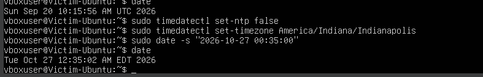
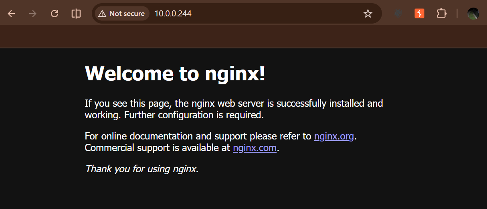
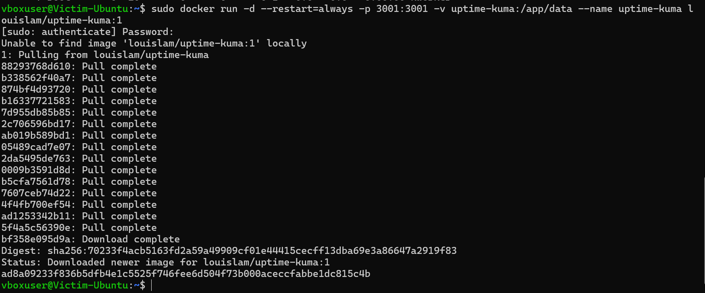
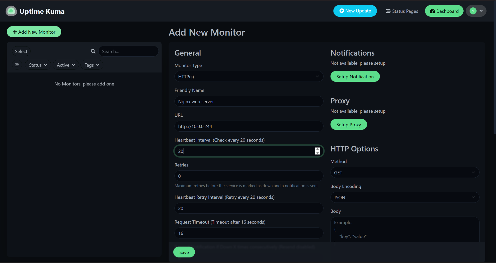
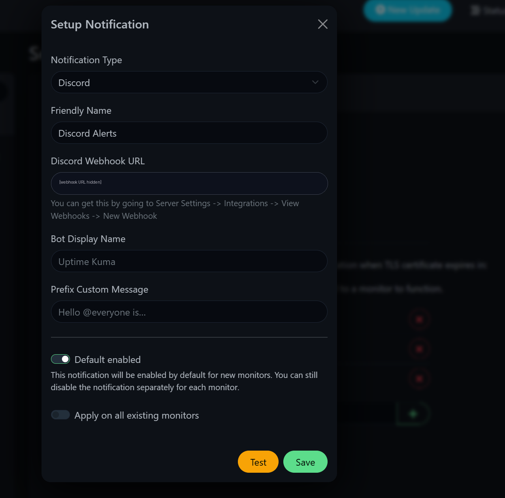
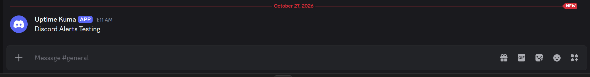
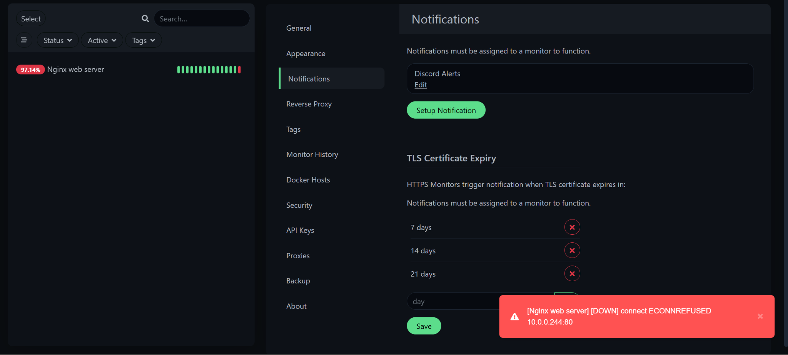
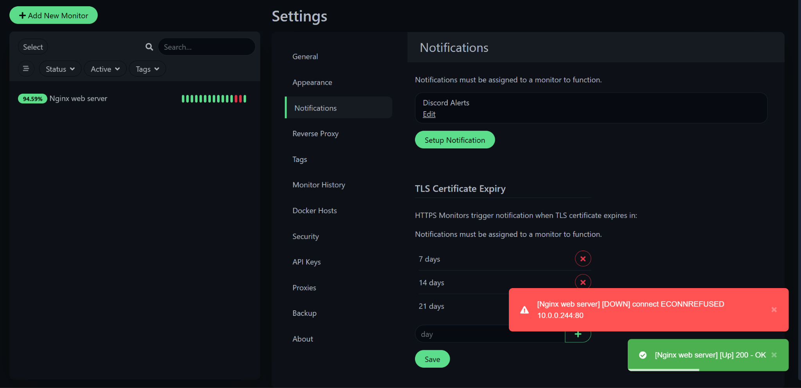

# NOC Monitoring Lab

A small home lab where I set up monitoring for a web server and got an alert when it went down.

I built this to practice **network operations center (NOC) work**: watching a service, getting an alert when something breaks, fixing it, and writing down the steps.

## What I used
- **VirtualBox** to run a virtual machine
- **Ubuntu Server** (Linux) on the VM
- **Nginx** as the web server
- **Docker** to run Uptime Kuma
- **Uptime Kuma** to monitor the web server
- **Discord** to send me alerts

## What I did

### 1. Set up the VM
I made an Ubuntu VM with 2 CPUs, 2 GB of RAM, and a 20 GB disk. I set the network to "Bridged Adapter" so my PC could reach it.

I ran `sudo apt update` and it failed with "Release file is not valid yet." The VM's clock was about 36 days behind, so I turned off automatic time sync, set the timezone, and set the date by hand. After that the update worked.



Then I installed Nginx and Docker:

```
sudo apt update && sudo apt install -y docker.io nginx
sudo systemctl enable --now docker nginx
ip a
```

I checked that the web server worked by opening the VM's IP address in my browser:



### 2. Install Uptime Kuma
I ran Uptime Kuma in Docker:

```
sudo docker run -d --restart=always -p 3001:3001 -v uptime-kuma:/app/data --name uptime-kuma louislam/uptime-kuma:1
```



### 3. Add a monitor
In Uptime Kuma I added an HTTP monitor for my web server. It checks the site every 20 seconds.



### 4. Set up Discord alerts
I made a Discord webhook and added it to Uptime Kuma as a notification. (The webhook link is hidden in the screenshot because it is private.)



I clicked Test and the message showed up in Discord:



### 5. Break it on purpose
I stopped the web server:

```
sudo systemctl stop nginx
```

Uptime Kuma showed the monitor as **DOWN** ("connect ECONNREFUSED"):



### 6. Fix it
I started the web server again:

```
sudo systemctl start nginx
```

Uptime Kuma showed the monitor as **UP** again:



## Runbook
I wrote a runbook for this problem: [runbook-web-server-down.md](runbook-web-server-down.md). It lists the symptom, the checks, the fix, and when to escalate.

## What I learned
- How to watch a service and get an alert when it goes down
- How to find and fix a problem with simple Linux commands (`systemctl`, `journalctl`, `df -h`)
- That a wrong system clock can stop updates from working
- How to write steps down so someone else can follow them

## What I want to do next
- Switch to the newest Uptime Kuma version (I used the older `:1` image)
- Add CPU and disk monitoring with Prometheus and Grafana
- Add more monitors and write runbooks for them
